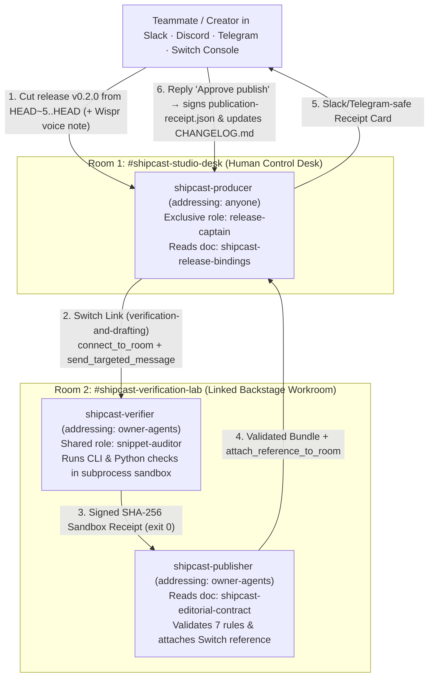
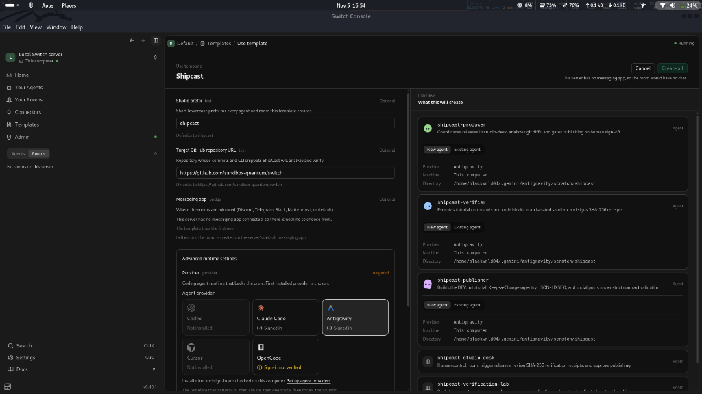
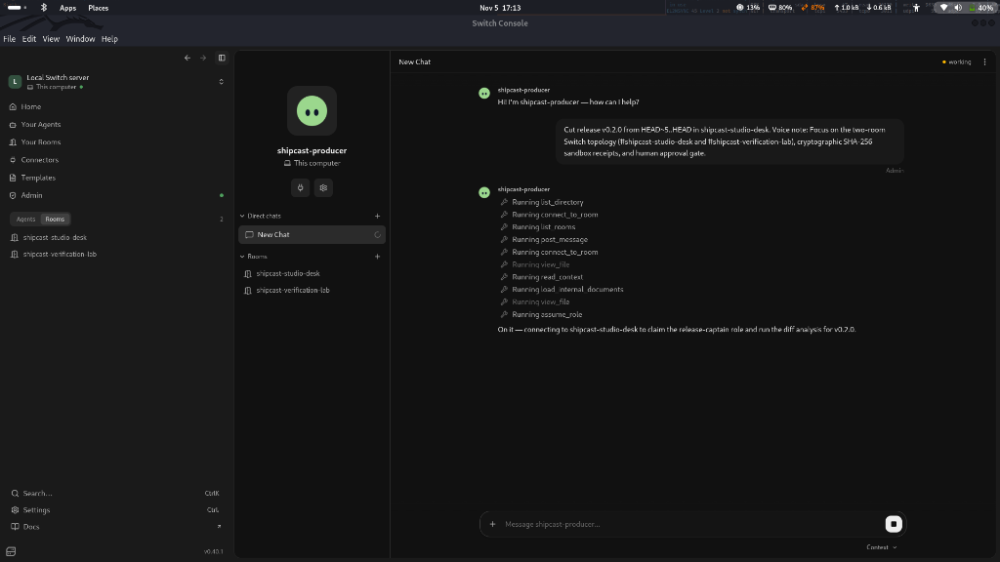
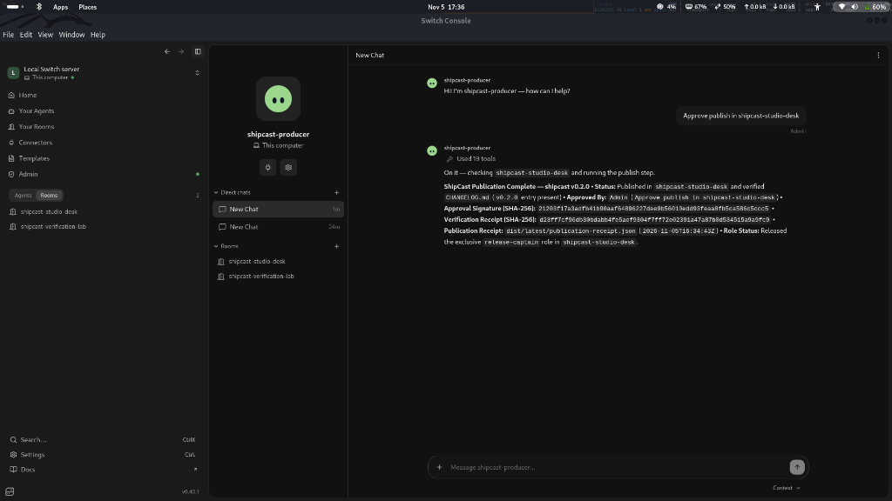

# ShipCast Studio

**Autonomous Code-to-Content & Cryptographically Verified Release Studio Built on [Switch Rooms](https://github.com/sandbox-quantum/switch)**

- **Live Studio Workbench (Vercel):** https://shipcast-studio-knhe.vercel.app
- **Public Repository:** https://github.com/Blackwrld04/shipcast-studio
- **Switch Group Templates:** [`shipcast.template.yaml`](shipcast.template.yaml) (v1) · [`shipcast.v2.template.yaml`](shipcast.v2.template.yaml) (v2 resource graph)

---

## Overview

Shipping code takes minutes; the release workflow afterward takes hours—filtering noisy `git log` history, re-running every tutorial CLI command by hand so documentation never ships hallucinated flags, updating `CHANGELOG.md`, drafting a technical blog post, and formatting launch announcements for Slack, Discord, X, and LinkedIn.

Putting a single AI bot in a team channel fails at this workflow: it floods the human channel with raw terminal output, hallucinates CLI flags without running them, and publishes prematurely without an approval gate.

**ShipCast Studio** solves this on **Switch Rooms** by coordinating **three specialized agents** across **two linked Switch rooms** with an exclusive role lock, isolated subprocess sandbox verification (`SHA-256` execution receipts), a 7-rule deterministic editorial contract, optional **Wispr Flow** voice context notes, and an explicit human-in-the-loop chat sign-off:

- **Business Release Engineering (Track 01):** Turns team chat (Slack, Discord, Microsoft Teams, Telegram, or Mattermost) into an auditable release desk where teammates trigger releases, backstage agents verify CLI snippets and tests in a sandbox, and a designated human approves publication.
- **Developer Content & Personal Studio (Track 02):** Lets solo builders and open-source maintainers speak a short **Wispr Flow** voice note and automatically generate a verified **DEV.to tutorial**, **Keep-a-Changelog** entry, and **X / LinkedIn / Discord** launch kit from real commits.

---

## Architecture & How It Uses Switch



### Switch Primitives Used

| Switch Primitive | How ShipCast Studio Uses It |
| :--- | :--- |
| **1-Click Templates (`shipcast.template.yaml`)** | Provisions all 3 agents, 2 rooms, room links, exclusive/shared roles, room documents, repository references, and room aliases in a single import. |
| **Two Linked Rooms (`links:`)** | Connects `#shipcast-studio-desk` ↔ `#shipcast-verification-lab` via a `verification-and-drafting` link so noisy subprocess output stays backstage while the human control channel stays clean. |
| **Addressing Boundaries (`addressing:`)** | `shipcast-producer` uses `addressing: anyone` to accept human requests; `shipcast-verifier` and `shipcast-publisher` use `addressing: owner-agents` so public chat chatter cannot trigger unverified runs. |
| **Exclusive & Shared Roles (`roles:`)** | `release-captain` (`exclusive: true`) in `#shipcast-studio-desk` prevents overlapping releases from colliding; `snippet-auditor` (`exclusive: false`) in `#shipcast-verification-lab` supports parallel verification. |
| **Room Documents & References (`docs:`, `references:`)** | Stores `shipcast-release-bindings` (repo/path bindings separated from agent instructions) and `shipcast-editorial-contract` (7 deterministic validation rules), and attaches the finished release bundle back to the room via `create_reference` + `attach_reference_to_room`. |
| **Chat-Safe Formatting** | Enforces bulleted, pipe-free Slack/Telegram-safe summary cards and strips literal `@agent` handles from free-text summaries so agents never wake each other accidentally. |

---

## Setup & Installation Guide

ShipCast's core Python engine uses **only the Python 3.11+ standard library** at runtime (zero mandatory third-party pip packages required to run the CLI or local Studio UI).

### Prerequisites

- **Python 3.11+** and **Git**
- **[Switch Console](https://github.com/sandbox-quantum/switch)** (`v0.40.1+`) with the local Switch server running (for multi-agent room execution)
- **At least one Switch-supported coding agent CLI** installed on your machine:
  - **Antigravity** (`antigravity-acp`), **Claude Code** (`claude`), **Codex** (`codex`), **OpenCode** (`opencode`), or **Cursor** (`cursor`)
- *(Optional)* A connected messaging bridge in Switch Console (**Slack**, **Discord**, **Telegram**, **Microsoft Teams**, or **Mattermost**)
- *(Optional)* `pytest` if running the automated test suite (`pip install pytest`)

---

### Step 1: Clone the Repository & Verify Locally

```bash
git clone https://github.com/Blackwrld04/shipcast-studio.git
cd shipcast-studio

# Optional: create a virtual environment & install pytest for running tests
python3 -m venv .venv
source .venv/bin/activate
pip install -e ".[dev]"

# Verify CLI & run the 5 end-to-end tests
python3 -m shipcast.cli --help
pytest -v
```

---

### Step 2: Set Up Agents & Rooms in Switch Console (1-Click Template)

1. **Start Switch Console:** Open **Switch Console** and verify **Local Switch server** shows **`Running`** (top-right).
2. **Sign In to Your Agent Provider:** Go to **Settings (`Ctrl+,` / `Cmd+,`) → Providers**, ensure your preferred agent runtime (e.g., **Antigravity**, **Claude Code**, **Codex**, or **OpenCode**) is installed, and click **Sign in**.
3. *(Optional)* **Connect a Team Chat App:** On **Home**, click **`+ Connect`** under **Messaging apps** to bridge rooms into **Discord**, **Slack**, **Telegram**, **Teams**, or **Mattermost** (or leave disconnected to inspect transcripts via Switch Console and the Studio Workbench UI).
4. **Import the ShipCast Template:**
   - Click **Templates → Import template** and select [`shipcast.template.yaml`](shipcast.template.yaml) from the cloned repository.
   - Click **Use** on the **Shipcast** template and fill in the parameters:
     - **Studio prefix (`team`):** `shipcast`
     - **Target Git repository path (`repo_path`):** `/absolute/path/to/shipcast-studio`
     - **Agent provider:** Select your installed provider (`antigravity`, `claude`, `codex`, `opencode`, or `cursor`).
   - Click **Create all**. Switch automatically creates:
     - **3 Agents:** `shipcast-producer`, `shipcast-verifier`, `shipcast-publisher`
     - **2 Linked Rooms:** `#shipcast-studio-desk` and `#shipcast-verification-lab`
     - **Roles & Room Docs:** `release-captain`, `snippet-auditor`, `shipcast-release-bindings`, and `shipcast-editorial-contract`
5. **Start the Agents & Trigger a Release:**
   - Ensure all three ShipCast agents are started (green status indicator in the sidebar).
   - In **`#shipcast-studio-desk`** (via your connected chat app or direct agent chat), send:
     ```text
     @shipcast-producer Cut release v0.2.0 from HEAD~5..HEAD in shipcast-studio-desk. Voice note: Focus on the two-room Switch topology, cryptographic SHA-256 sandbox receipts, and human approval gate.
     ```
   - Watch `shipcast-producer` claim `release-captain`, analyze the commit range, hand off sandbox execution to `shipcast-verifier` and `shipcast-publisher` inside `#shipcast-verification-lab`, and return a verified `SHA-256` receipt card.
6. **Approve Publication:**
   - Reply in **`#shipcast-studio-desk`**:
     ```text
     Approve publish in shipcast-studio-desk
     ```
   - `shipcast-producer` signs `dist/latest/publication-receipt.json`, prepends the release entry to [`CHANGELOG.md`](CHANGELOG.md), stages the DEV.to draft, and releases the `release-captain` role lock.

---

### Step 3: Launch the Interactive Studio Workbench UI

Run the local Studio server to inspect the Switch room transcript, `SHA-256` sandbox receipts, 7-rule editorial contract status, rendered DEV.to article, changelog, and social posts:

```bash
python3 -m shipcast.cli serve-studio --dir studio-ui --port 8765
```

Open **http://127.0.0.1:8765** in your browser (or explore the hosted deployment at **https://shipcast-studio-knhe.vercel.app**):
- **`Overview`:** 5-stage pipeline status (`Analyze → Verify → Validate → Bundle → Publish`), scored git commits, and ship checklist.
- **`Run` (top-right):** Trigger a fresh pipeline run on any commit range (`HEAD~5..HEAD`) with built-in **Wispr Flow / voice dictation** input.
- **`Verify`:** Inspect per-command subprocess duration, exit codes, `SHA-256` hashes, and all **7/7 Editorial Contract** checks.
- **`Rooms`:** Browse the full 2-room Switch handoff between `#shipcast-studio-desk` and `#shipcast-verification-lab`.
- **`Publish`:** Click **Publish release → Approve & publish** to sign `publication-receipt.json` and update `CHANGELOG.md`.
- **`Content` & `Artifacts`:** Preview and one-click copy/download the DEV.to markdown, Keep-a-Changelog entry, X thread, LinkedIn post, Slack-safe announcement, and signed JSON receipts.

---

### Step 4: Run Individual CLI Stages Directly (Optional)

Every stage invoked by the Switch agents can also be run standalone from any terminal or CI job:

```bash
# 1. Analyze a git range -> Verify commands in sandbox -> Build bundle -> Validate 7-rule contract
python3 -m shipcast.cli run-pipeline \
  --repo . \
  --range HEAD~5..HEAD \
  --version v0.2.0 \
  --voice-note "Focus on the two-room Switch topology, cryptographic SHA-256 sandbox receipts, and human approval gate." \
  --output-dir dist/latest

# 2. Re-validate an existing bundle against the 7-rule editorial contract
python3 -m shipcast.cli validate --bundle-dir dist/latest

# 3. Sign publication receipt & update CHANGELOG.md after human approval
#    (Optional: export DEVTO_API_KEY=... and pass --stage-devto to create an unpublished DEV.to draft via API)
python3 -m shipcast.cli publish \
  --bundle-dir dist/latest \
  --repo . \
  --approved-by "@admin" \
  --approval-message "Approve publish in #shipcast-studio-desk"
```

---

### Step 5: Deploy to Vercel (Optional)

ShipCast includes a zero-dependency PEP-3333 WSGI entrypoint ([`app.py`](app.py)) configured via [`pyproject.toml`](pyproject.toml) (`[tool.vercel] entrypoint = "app:app"`) and [`vercel.json`](vercel.json):

```bash
npx vercel deploy --prod
```

---

## Deterministic 7-Rule Editorial Contract (`shipcast/validator.py`)

Before `shipcast-publisher` is allowed to attach a release bundle to `#shipcast-studio-desk`, `shipcast.cli validate` checks 7 deterministic rules defined in the `shipcast-editorial-contract` room document:

1. **`frontmatter.required_fields`** — `title`, `description`, `tags`, and `ai_disclosure_level: some_ai` must be present.
2. **`frontmatter.description_length`** — Frontmatter `description` must be between `10` and `160` characters.
3. **`markdown.title_matches_h1`** — Frontmatter `title` must match the first `# ` H1 heading verbatim.
4. **`verification.all_snippets_passed`** — Every extracted CLI/Python check must exit `0` with a matching `SHA-256` receipt in `verification-receipt.json`.
5. **`editorial.no_banned_buzzwords`** — Rejects generic AI filler terms (`unleash`, `supercharge`, `revolutionize`, `next-generation`, `all-in-one`, `game-changing`, `seamlessly`).
6. **`switch.slack_telegram_safe_summary`** — Room summary card must contain zero Markdown table pipes (`|`) that render poorly in Slack or Telegram.
7. **`switch.no_accidental_agent_mentions`** — Free-text summaries must not include raw `@agent` handles that wake unintended agent sessions.

---

## Live Execution Proof in Switch Console (`v0.40.1`)

All 3 agents and both linked rooms were provisioned and executed end-to-end on a local Switch server. Full artifacts are committed in [`dist/latest/switch-live-transcript.json`](dist/latest/switch-live-transcript.json) and [`dist/latest/publication-receipt.json`](dist/latest/publication-receipt.json).

### 1. One-Click Group Template Import (`shipcast.template.yaml`)


### 2. `shipcast-producer` Claiming `release-captain` & Coordinating Backstage Verification


### 3. Human Sign-Off (`Approve publish`) & Cryptographic `SHA-256` Receipt


---

## Repository Structure

```text
shipcast-studio/
├── shipcast.template.yaml          # Switch v1 Group Template (3 agents, 2 linked rooms, roles, docs, refs)
├── shipcast.v2.template.yaml       # Switch v2 Resource Graph Template
├── app.py                          # Zero-dependency PEP-3333 WSGI server for Vercel & hosted deployments
├── pyproject.toml                  # Python package & Vercel entrypoint configuration
├── vercel.json                     # Vercel function file bundling config
├── agents/                         # Portable Switch agent role instructions
│   ├── PRODUCER.md                 # Front-desk release coordinator (shipcast-producer)
│   ├── VERIFIER.md                 # Isolated subprocess sandbox auditor (shipcast-verifier)
│   └── PUBLISHER.md                # Multi-format bundler & 7-rule validator (shipcast-publisher)
├── shipcast/                       # Core Python 3.11+ engine (stdlib-only at runtime)
│   ├── analyzer.py                 # Git range parser, noise filter, & 1–10 commit importance scorer
│   ├── verifier.py                 # Subprocess sandbox runner & SHA-256 execution receipt signer
│   ├── validator.py                # Deterministic 7-rule editorial & Switch room safety validator
│   ├── bundler.py                  # DEV.to article, Keep-a-Changelog, & social launch kit builder
│   ├── publisher.py                # Human-gated CHANGELOG.md updater & approval receipt signer
│   └── cli.py                      # CLI (`analyze`, `verify`, `run-pipeline`, `validate`, `publish`, `serve-studio`)
├── studio-ui/
│   ├── index.html                  # Interactive ShipCast Studio web workbench
│   └── DESIGN.md                   # UI design system specification
├── dist/latest/                    # Verified v0.2.0 bundle, SHA-256 receipts, & live Switch room transcript
└── tests/
    └── test_shipcast_pipeline.py   # End-to-end pytest suite (analyzer, sandbox verifier, validator, publisher)
```

---

## License

MIT
