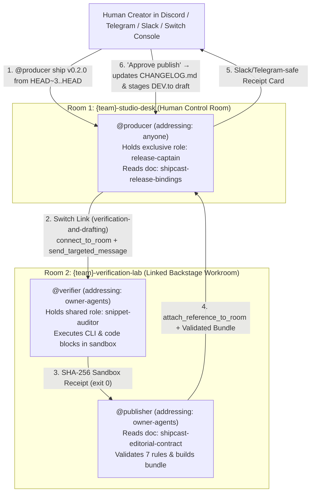

# ShipCast Studio — Autonomous Code-to-Content & Verified Release Studio on Switch Rooms

**ShipCast** turns a git commit range (plus an optional voice-dictated context note from **Wispr Flow**) into a **cryptographically verified release & content bundle** inside **Switch Rooms** (Discord, Telegram, Slack, Mattermost, or Switch Console).

Instead of trusting a single chatbot to summarize `git log` and publish unchecked tutorial commands, ShipCast coordinates **three specialized agents** across **two linked Switch rooms** (`{team}-studio-desk` and `{team}-verification-lab`) with an exclusive role lock (`release-captain`), a subprocess sandbox verifier (`SHA-256` execution receipts), a 7-rule deterministic editorial contract, and an explicit human sign-off gate.

---

## Architecture: Why Switch Rooms Are Essential



### Switch Primitives Used (`shipcast.template.yaml`)

| Switch Feature | Implementation in ShipCast |
| :--- | :--- |
| **Group Template (`version: 1` & `version: 2`)** | `shipcast.template.yaml` (local Switch Console & managed servers) + `shipcast.v2.template.yaml` (resource graph). Provisions all 3 agents, 2 rooms, links, roles, docs, references, and aliases in one pass. |
| **Linked Rooms (`links:`)** | Connects `{team}-studio-desk` ↔ `{team}-verification-lab` so noisy subprocess test output stays in `#verification-lab` while `#studio-desk` remains a clean audit log. |
| **Addressing Boundaries (`addressing:`)** | `{team}-producer` uses `addressing: anyone` to speak with teammates; `{team}-verifier` and `{team}-publisher` use `addressing: owner-agents` so public chatter cannot trigger unverified runs. |
| **Exclusive & Shared Roles (`roles:`)** | `release-captain` (`exclusive: true`) in `#studio-desk` prevents overlapping releases; `snippet-auditor` (`exclusive: false`) in `#verification-lab` handles parallel sandbox checks. |
| **Room Documents (`docs:`) & References (`references:`)** | Pre-loads `shipcast-release-bindings` (`knowledge/procedure-vs-bindings` pattern) and `shipcast-editorial-contract` (7 deterministic validation rules), plus a `github` repository reference. |
| **Room Aliases (`aliases:`) & Gotchas Compliance** | Short handles (`@producer`, `@verifier`, `@publisher`), Slack/Telegram-safe bulleted summaries (zero raw Markdown tables), and zero accidental `@agent` mentions in free text. |

---

## Quickstart (Reproduce in 60 Seconds)

### Step 1: Clone & Verify the Local CLI + Test Suite

```bash
git clone <your-repo-url> shipcast
cd shipcast
pytest -v
```

### Step 2: Run the End-to-End Release Pipeline Locally

```bash
# 1. Run full git diff analysis -> sandbox command verification -> bundling -> 7-rule contract check
python3 -m shipcast.cli run-pipeline \
  --repo . \
  --range HEAD~3..HEAD \
  --version v0.2.0 \
  --voice-note "Dictated with Wispr Flow: Highlight the two linked Switch rooms and SHA-256 sandbox receipts." \
  --output-dir dist/latest

# 2. Validate the generated bundle against the 7-rule editorial contract
python3 -m shipcast.cli validate --bundle-dir dist/latest

# 3. Publish after human sign-off (updates CHANGELOG.md & writes publication-receipt.json)
python3 -m shipcast.cli publish \
  --bundle-dir dist/latest \
  --repo . \
  --approved-by "creator" \
  --approval-message "Approve publish"
```

### Step 3: Launch the Interactive Studio Workbench UI

```bash
python3 -m shipcast.cli serve-studio --dir studio-ui --port 8765
```
Open `http://127.0.0.1:8765` to inspect the live Switch Room trace, the SHA-256 sandbox verification receipts, the 7/7 contract audit table, the generated DEV.to tutorial, and the X/LinkedIn social posts.

### Step 4: Import into Switch Console (1-Click Setup)

1. Open **Switch Console** and ensure your local server is running.
2. Go to **Templates → Import template** and select [`shipcast.template.yaml`](shipcast.template.yaml).
3. Keep the default studio prefix (`shipcast`), select your messaging bridge (Discord, Telegram, Slack, Mattermost, or built-in room chat), and click **Create all**.
   - *Tip:* Every agent entry sets `allow_existing: true` and `default: [antigravity, claude, codex, opencode, cursor]`, so Switch Console automatically selects your installed coding agent CLI or lets you swap in an existing agent.
4. In **`#shipcast-studio-desk`**, send:
   ```text
   @producer ship release v0.2.0 from HEAD~3..HEAD
   ```
5. Watch `@producer` claim `release-captain`, escalate verification to `@verifier` and `@publisher` in **`#shipcast-verification-lab`**, and post the verified receipt card back in **`#shipcast-studio-desk`**.
6. Reply `Approve publish` to update `CHANGELOG.md` and stage the live DEV.to tutorial draft.

---

## Repository Structure

```text
shipcast/
├── shipcast.template.yaml          # Switch v1 Group Template (3 agents, 2 linked rooms, roles, docs, refs)
├── shipcast.v2.template.yaml       # Switch v2 Resource Template (for servers with agent_management)
├── agents/                         # Portable agent instructions (procedure-vs-bindings pattern)
│   ├── PRODUCER.md                 # Front-desk coordinator (@producer)
│   ├── VERIFIER.md                 # Sandbox subprocess verifier (@verifier)
│   └── PUBLISHER.md                # Multi-format bundler & contract validator (@publisher)
├── shipcast/                       # Zero-dependency Python 3.11+ package
│   ├── analyzer.py                 # Git commit range parser & 1-10 Importance Scorer
│   ├── verifier.py                 # Subprocess sandbox runner & SHA-256 receipt signer
│   ├── validator.py                # 7-rule deterministic contract & Switch gotchas validator
│   ├── bundler.py                  # DEV.to tutorial, Keep-a-Changelog, JSON-LD SEO, & social generator
│   ├── publisher.py                # Human-gated CHANGELOG.md & DEV.to draft publisher
│   └── cli.py                      # Unified CLI (`analyze`, `verify`, `run-pipeline`, `validate`, `publish`, `serve-studio`)
├── studio-ui/
│   └── index.html                  # Interactive Studio Workbench UI (Switch trace + SHA-256 inspector)
└── tests/
    └── test_shipcast_pipeline.py   # End-to-end pytest suite
```
