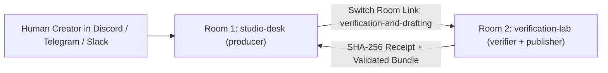

# Shipping shipcast v0.2.0 with Switch Rooms: Verified Multi-Agent Release Notes

Every code release normally ends with a manual chore: reading `git log`, checking which CLI flags changed, testing code snippets by hand so tutorials do not lie, and formatting release notes across multiple channels.

For **shipcast `v0.2.0`**, we automated this workflow inside **Switch Rooms** using two linked rooms (`studio-desk` and `verification-lab`) and three specialized agents (`producer`, `verifier`, and `publisher`) governed by an explicit human sign-off gate.

> **Creator Note (Dictated in Switch Room):** Focus on the two-room Switch topology (#studio-desk and #verification-lab), cryptographic SHA-256 sandbox receipts, and how Wispr Flow voice notes steer the Producer agent before human approval.

## 1. Architecture: Why Two Linked Switch Rooms Beat a Single Bot

Instead of trusting one prompt to summarize commits and publish unchecked markdown, ShipCast separates coordination, sandbox execution, and contract validation across two linked Switch rooms:



- **Room 1 (`studio-desk`)**: Holds the human creator and the `producer` agent (`addressing: anyone`), which claims the exclusive `release-captain` role so overlapping releases never collide.
- **Room 2 (`verification-lab`)**: Holds `verifier` and `publisher` (`addressing: owner-agents`). They cannot be triggered by random channel chatter—only by structured handoffs from `producer`.

## 2. What Shipped in `shipcast v0.2.0`

Our git analyzer scanned `HEAD~5..HEAD` (5 total commits, filtering out 1 low-signal commits) and scored this release **10/10** across **36 files** (`+3471 / -42` lines):

- **`722574d` — feat(studio): add live interactive API endpoints and hackathon submission kit** (`+261 / -42` lines across `README.md, SUBMISSION_KIT.md, agents/PRODUCER.md`)
- **`297e8c9` — docs(release): publish verified v0.2.0 release bundle and CHANGELOG.md** (`+753 / -0` lines across `CHANGELOG.md, dist/latest/bundle-data.json, dist/latest/changelog-entry.md`)
- **`e486111` — feat(switch): add linked two-room Switch templates, agent briefs, and Studio Workbench UI** (`+1845 / -0` lines across `README.md, agents/PRODUCER.md, agents/PUBLISHER.md`)
- **`b7f7c7a` — feat(pipeline): add multi-format release bundler and human-gated CHANGELOG publisher** (`+612 / -0` lines across `shipcast/bundler.py, shipcast/cli.py, shipcast/publisher.py`)

## 3. Sandbox Verification Receipts (`verification-lab`)

Before `publisher` was allowed to draft this post, `verifier` executed every command in an isolated subprocess and recorded its cryptographic SHA-256 receipt (`4e659d6e9a14709a0c9d...`):

### Check #1: `PASS (exit 0)` in 139ms
- **Receipt SHA-256:** `9e0b9428774d2022a14257b0...`

```bash
python3 -m shipcast.cli --help
```

**Captured Sandbox Output:**
```text
usage: shipcast [-h]
                {analyze,verify,run-pipeline,validate,publish,serve-studio} ...

ShipCast: Autonomous Code-to-Content & Verified Release Studio for Switch
Rooms

positional arguments:
  {analyze,verify,run-pipeline,validate,publish,serve-studio}
    analyze             Analyze a git commit range and score importance
    verify              Execute commands/snippets in sandbox & sign receipt
    run-pipeline        Run full analyze -> verify -> bundle -> validate
                        pipeline and print Switch receipt
    validate            Validate a generated release bundle against contract
    publish             Publish a validated bundle after human approval
    serve-studio        Serve the local ShipCast Studio web UI

options:
  -h, --help            show this help message and exit
```

## 4. Reproducing This Setup in Switch Console

Clone the repository and import `shipcast.template.yaml` into **Switch Console → Templates → Import template** to stand up all three agents, both linked rooms, the room-scoped editorial contract document, and the `release-captain` role in one click.
