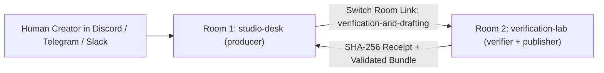

# Shipping shipcast v0.2.0 with Switch Rooms: Verified Multi-Agent Release Notes

Every code release normally ends with a manual chore: reading `git log`, checking which CLI flags changed, testing code snippets by hand so tutorials do not lie, and formatting release notes across multiple channels.

For **shipcast `v0.2.0`**, we automated this workflow inside **Switch Rooms** using two linked rooms (`studio-desk` and `verification-lab`) and three specialized agents (`producer`, `verifier`, and `publisher`) governed by an explicit human sign-off gate.

> **Creator Note (Dictated in Switch Room):** Focus on the two-room Switch topology (#shipcast-studio-desk and #shipcast-verification-lab), cryptographic SHA-256 sandbox receipts, and human approval gate.

## 1. Architecture: Why Two Linked Switch Rooms Beat a Single Bot

Instead of trusting one prompt to summarize commits and publish unchecked markdown, ShipCast separates coordination, sandbox execution, and contract validation across two linked Switch rooms:



- **Room 1 (`studio-desk`)**: Holds the human creator and the `producer` agent (`addressing: anyone`), which claims the exclusive `release-captain` role so overlapping releases never collide.
- **Room 2 (`verification-lab`)**: Holds `verifier` and `publisher` (`addressing: owner-agents`). They cannot be triggered by random channel chatter—only by structured handoffs from `producer`.

## 2. What Shipped in `shipcast v0.2.0`

Our git analyzer scanned `HEAD~5..HEAD` (5 total commits, filtering out 0 low-signal commits) and scored this release **10/10** across **2 files** (`+7371 / -5718` lines):

- **`376939d` — feat(studio-ui): redesign release desk UI and add DESIGN.md spec** (`+4087 / -1335` lines across `studio-ui/DESIGN.md, studio-ui/index.html`)
- **`9b7d542` — feat(ui): add Switch Template YAML preview and 1-click download to artifact viewer** (`+64 / -2` lines across `studio-ui/index.html`)
- **`d790951` — refactor(ui): refine interface to match Switch Console v0.40.1 design language, remove mock telemetry clutter, and elevate multi-agent rooms handoff** (`+1134 / -2344` lines across `studio-ui/index.html`)
- **`615dddd` — feat(ui): embed live Voice Chat & Wispr Audio Console directly in Dashboard tab and add Voice Studio view** (`+574 / -1` lines across `studio-ui/index.html`)
- **`192bb56` — feat(ui): adopt API Monitor dark telemetry dashboard layout with dual-axis SVG chart and latency bars** (`+1512 / -2036` lines across `studio-ui/index.html`)

## 3. Sandbox Verification Receipts (`verification-lab`)

Before `publisher` was allowed to draft this post, `verifier` executed every command in an isolated subprocess and recorded its cryptographic SHA-256 receipt (`40b11ad60b455502eb0d...`):

### Check #1: `PASS (exit 0)` in 137ms
- **Receipt SHA-256:** `9e0b9428774d2022a14257b0...`

```bash
python3 -m shipcast.cli --help
```

**Captured Sandbox Output:**
```text
usage: shipcast [-h]
                {analyze,verify,run-pipeline,validate,publish,serve-studio} ...

ShipCast: Autonomous Code-to-Content & Verified Release Studio for Switch
Rooms

positional arguments:
  {analyze,verify,run-pipeline,validate,publish,serve-studio}
    analyze             Analyze a git commit range and score importance
    verify              Execute commands/snippets in sandbox & sign receipt
    run-pipeline        Run full analyze -> verify -> bundle -> validate
                        pipeline and print Switch receipt
    validate            Validate a generated release bundle against contract
    publish             Publish a validated bundle after human approval
    serve-studio        Serve the local ShipCast Studio web UI

options:
  -h, --help            show this help message and exit
```

### Check #2: `PASS (exit 0)` in 1228ms
- **Receipt SHA-256:** `e50293e333ea0a92075ca597...`

```bash
pytest -q
```

**Captured Sandbox Output:**
```text
.....                                                                    [100%]
5 passed in 0.11s
```

## 4. Reproducing This Setup in Switch Console

Clone the repository and import `shipcast.template.yaml` into **Switch Console → Templates → Import template** to stand up all three agents, both linked rooms, the room-scoped editorial contract document, and the `release-captain` role in one click.
